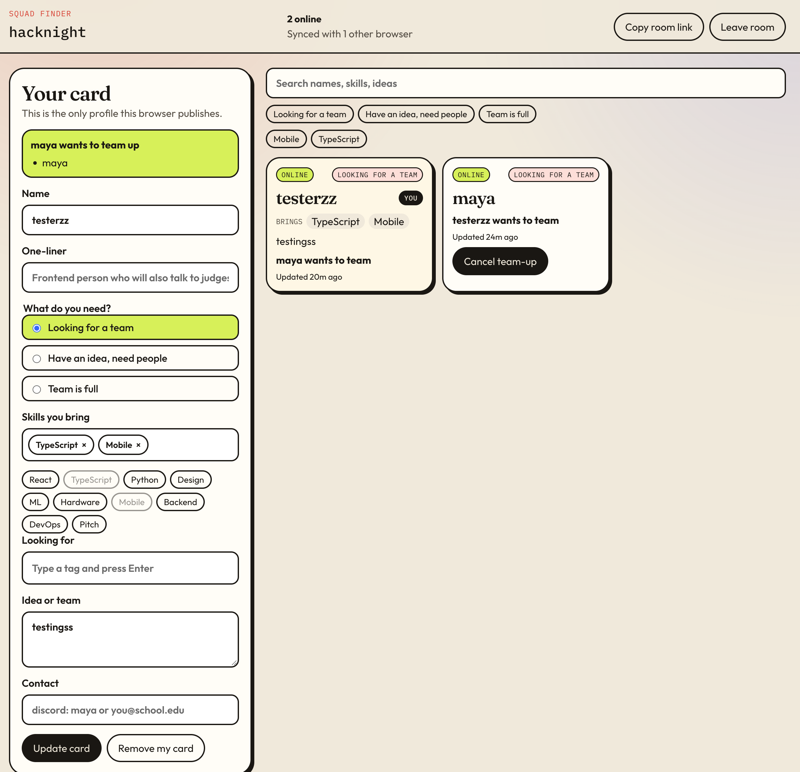

# Squad Finder



A small hackathon board for finding teammates. Profiles live in a [Yjs](https://docs.yjs.dev/) document stored in IndexedDB. Encrypted updates are forwarded through a public MQTT relay (HiveMQ, then EMQX if that is unreachable) so browsers on different networks merge the same board. The room code is the encryption key. The relay cannot read the profiles.

```bash
npm install
npm run dev
```

Open the same room in two browsers and publish a card in each.
